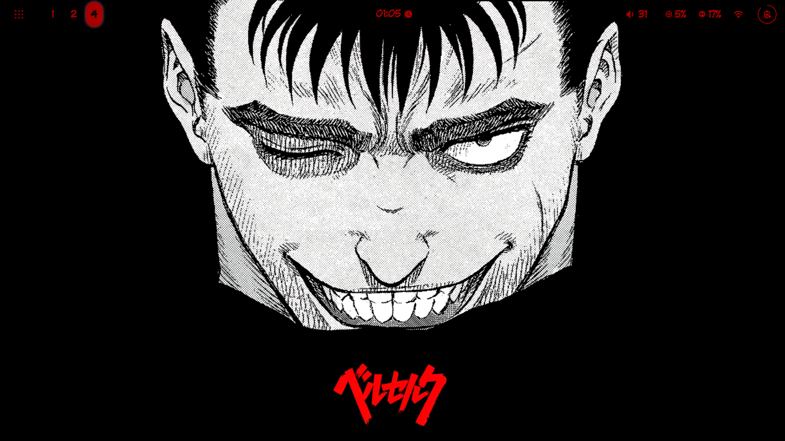
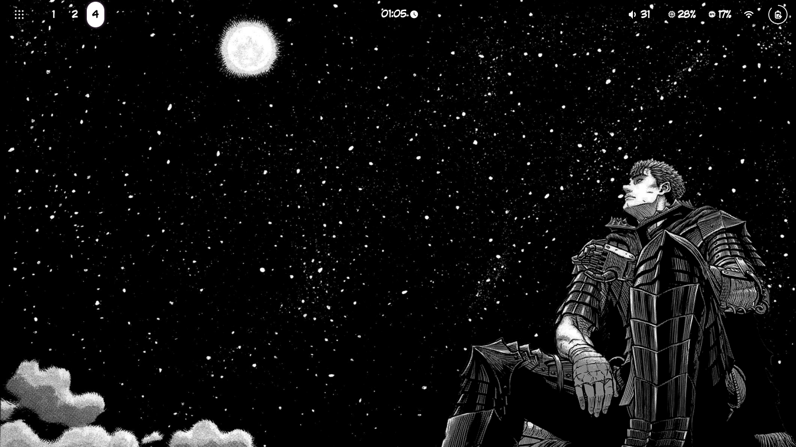

# My Dotfiles

Welcome to my dotfiles! This configuration is heavily inspired by **Berserk** and features a custom setup using [AGS (Aylur's GTK Shell)](https://github.com/Aylur/ags/) along with **Hyprland**.

## Features

- **Window Manager**: Hyprland for dynamic tiling and smooth performance.
- **Shell**: Custom GTK theming using [AGS](https://github.com/Aylur/ags/).
- **Inspired by**: The aesthetics of the manga/anime **Berserk**.

## Screenshots

Here are some screenshots of my desktop setup:

### AGS in Action


### Custom Configurations


## Getting Started

To use this configuration:

1. Clone the repository:
    ```bash
    git clone https://github.com/Nebton/dotfiles.git
    cd dotfiles
    ```
2. Install Hyprland, Hyprpaper 0.8+, **AGS 1.8.2** (`aylurs-gtk-shell`),
   GJS, and the dependencies used by your widgets. This config uses the AGS 1 API.
3. Link the desktop configuration and compatibility launcher:
    ```bash
    mkdir -p ~/.config ~/.local/bin ~/.local/share/ags-compat
    # Back up existing files/directories before replacing them with these links.
    ln -s "$PWD/hypr" ~/.config/hypr
    ln -s "$PWD/ags" ~/.config/ags
    ln -s "$PWD/Scripts" ~/Scripts
    ln -s "$PWD/wallpaper_colors.conf" ~/.config/wallpaper_colors.conf
    ln -s "$PWD/local/bin/ags" ~/.local/bin/ags
    ln -s "$PWD/local/share/ags-compat/launcher.js" ~/.local/share/ags-compat/launcher.js
    ```
   The wallpaper script also updates the existing Kitty, Rofi, Neovim, and Zsh
   configurations. Link those directories to `~/.config/` as appropriate.
4. Put your wallpapers in `~/Wallpapers` with matching entries in
   `wallpaper_colors.conf`. Update the `/home/doom` paths in `hypr/hyprland.conf`
   if installing for another user.
5. Restart Hyprland to run the startup commands.

## Desktop controls and compatibility

- **Super+R** selects a wallpaper and applies its theme colors. Hyprpaper uses a
  `wallpaper` block with an empty monitor to cover all connected displays.
- **Super+W** starts the widgets; **Super+Shift+W** closes them.
- **Super+Space** switches keyboard layouts; **Alt+Space** holds to dictate in Hex.
  In Hex, enable **Start listening when Hex opens** (`hex settings set enable_on_launch on`).
- **Super+L** locks the desktop; **Super+H/J** cycles previous/next window.
- **Super+F** toggles fullscreen; **Super+Shift+F** toggles maximization.
- Kitty uses **Noto Sans Cuneiform** at font size **13**. Ctrl+V is passed to
  terminal applications so they can handle clipboard images. Hex uses its
  Terminal paste shortcut setting (`hex settings set paste_with_shift on`)
  to paste dictation with Ctrl+Shift+V instead.
- The bar uses JetBrains Mono Nerd Font Mono, a transparent background, and
  the wallpaper accent. Workspace buttons are only recreated when workspace IDs
  change, avoiding flicker from window-title updates.
- Below **20%** while unplugged, the battery icon flashes red and a persistent
  critical notification asks you to connect the charger. The alert fires once
  per episode, rearming after charging starts or the battery reaches 22%.
- CPU and memory usage are sampled directly from `/proc` every 3 and 5 seconds;
  the clock uses GLib without starting shell commands.
- Clipboard watching and the network applet start once per session, so config
  reloads do not launch duplicate instances.
- `local/bin/ags` sets typelib/library paths before launching the tracked AGS 1
  entry point. This avoids the removed static GIRepository calls in newer GJS,
  without changing package-managed files in `/usr/bin`.
- Tray buttons bind each application's icon and tooltip; left click activates
  the application (or opens its menu when requested), right click opens its menu.
- Notification titles and bodies wrap without ellipses. Long message bodies
  scroll after 360 pixels; ordinary messages expand to show all their text.
  Long title-only messages use the app name as a heading and display the message
  in the body. Text already shortened by the sender cannot be recovered.
- Wallpaper logs are written to `~/.local/state/hypr/hyprpaper.log`.

## Codex desktop notifications

Merge `codex/notifications.toml` into `~/.codex/config.toml`, preserving your
existing settings. The top-level `notify` command runs
`Scripts/codex-notify.py` after each completed turn. It sends the complete reply
to AGS with a short heading, removes Markdown decoration, and escapes notification
markup. Restart Codex after changing its configuration (`codex resume` lets you
reopen a conversation).

Kitty's `filter_notification all` disables its terminal notification route to
prevent duplicate, shortened notices. Applications that send desktop notifications
directly still use AGS as usual. The Codex configuration fragment contains no
account settings or credentials.

## Notes

- These dotfiles are optimized for a system running **Hyprland** with a GTK environment.
- Ensure you have all dependencies installed as required by [AGS](https://github.com/Aylur/ags/).


